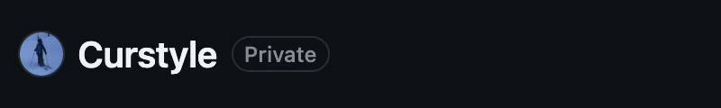

# Curstyle

**Make your macOS cursor your own.**

Replace system cursors for pointing, text selection, links, window resizing, and more. Import Windows cursor themes or Mousecape `.cape` files, preview their animations, and fine-tune them before applying.

[](docs/assets/demo.mp4)

[Watch the video](docs/assets/demo.mp4) · Cursor theme: [Bibata Modern Amber](https://github.com/ful1e5/Bibata_Cursor)

> [!WARNING]
> Curstyle is under development and uses private macOS APIs (SkyLight / HIServices / AccessibilityFoundation). An OS update may break compatibility. The tested environment is **macOS 27.2 on Apple Silicon**.

## Features

- **Import themes** from Windows `.cur` / `.ani` files, Mousecape `.cape` files, or Curstyle's `theme.json` format.
- **Preview before applying**, with animated previews, selectable backgrounds, and hotspot markers.
- **Adjust your cursors** by editing hotspots, sizes, and animation speed, or replacing individual cursors with GIF / PNG images.
- **Switch and restore** from the app or menu bar.
- **Reapply automatically** when a restart, login, or pointer setting change resets your theme.
- **Diagnose problems** and export a report from Settings.

## Build and run

You need Xcode with a Swift 6 toolchain. The deployment target is macOS 14, but this does not guarantee compatibility with every subsequent OS release. Intel Macs have not been tested.

```bash
git clone https://github.com/Narcissus-tazetta/Curstyle.git
cd Curstyle
./make-app.sh
open "$HOME/Applications/Curstyle.app"
```

The script builds the app and CLI in release mode, applies an ad-hoc signature, and installs the bundle at `~/Applications/Curstyle.app`. It replaces any existing Curstyle app at that location.

## Getting started

Curstyle supports English and Japanese. With no saved language preference, it uses Japanese when your primary macOS language is Japanese, and English otherwise. Choose **English** or **日本語** under **Settings → App → Language** to save an override. App content updates immediately; restart Curstyle to update standard macOS menus and dialogs.

1. Download a cursor theme and extract its archive if needed.
2. Drag the theme folder or `.cape` file into the app window. You can also use **+** (⌘O) or drop it onto the Dock icon.
3. Check the cursor roles, size, and any skipped files, then choose **Add to Library**.
4. Select the theme and choose **Apply This Theme**.

To undo the change, choose **Restore Defaults** in the theme view, at the bottom of the sidebar, or in the menu bar.

### Supported formats

| Format | What to import | Notes |
| --- | --- | --- |
| Windows cursors | A folder containing `.cur` / `.ani` files | Roles are detected from INF metadata or filenames. Animated files take priority when both versions exist for a role |
| Mousecape | A `.cape` file | Imports images, animations, and hotspots |
| Curstyle | A folder containing `theme.json` and its images | Imports an existing Curstyle theme |
| GIF / PNG | An image selected in the cursor editor | Replaces an individual cursor within a theme |

Windows themes default to **1 px = 1 pt**: a 32 px image becomes a 32 pt cursor. For a smaller cursor, select **Smaller (2 px = 1 pt)** during import. Files with unrecognized roles or no macOS equivalent are skipped.

Animations with more than 24 frames are automatically reduced to 24 frames during import. The total loop duration is preserved, but motion becomes less smooth. The import preview and CLI report these adjustments. GIF replacements use the same conversion.

### Editing cursors

Click a cursor tile to open its editor. Set the hotspot (the click location) numerically, or click and drag in the preview. You can adjust animation speed per cursor, or use the theme's **…** menu to change the size or animation speed for the whole theme.

Saving edits to an active theme does not immediately change the system cursor. Choose **Apply Changes** to apply them.

### Keeping your theme after login

In Settings, enable **Automatically reapply lost themes** to register the background helper. If macOS requests approval, allow Curstyle to run in the background under **System Settings → Login Items**.

**Show in menu bar at login** is a separate setting. It is not required for automatic reapplication.

## Limitations and troubleshooting

### The cursor does not change

Reset pointer colors to their defaults under **System Settings → Accessibility → Display → Pointer**. Curstyle refuses to apply themes while custom pointer colors are enabled, and diagnostics explain this state.

Cursors registered independently by other apps, such as the screenshot crosshair (⌘⇧4), cannot be replaced.

### The theme disappears after login or a settings change

macOS can reset cursor images. Enable the background helper if you want Curstyle to reapply your theme automatically.

If the theme repeatedly disappears immediately after reapplication, the helper pauses and sends a notification. Check the reason in Settings and choose **Resume**.

### Restoring the default cursors

Use **Restore Defaults** in the app. If the app does not open, run:

```bash
"$HOME/Applications/Curstyle.app/Contents/MacOS/curstyle" restore
```

If that does not work, the following command asks macOS to restore its defaults without using the saved images. Reset pointer colors to their defaults before running it.

```bash
"$HOME/Applications/Curstyle.app/Contents/MacOS/curstyle" reset-system
```

Logging out and back in also resets the cursors. Disable automatic reapplication first, or the background helper will apply your theme again.

### Diagnostics and saved data

Open **Diagnostics** in Settings to inspect the current state, and choose **Export Report** to save a diagnostic report.

Curstyle stores its data in `~/Library/Application Support/Curstyle/`. Imported themes live in `themes/`; the same data directory also holds default-cursor snapshots, theme application state, and helper logs. Do not delete snapshots while a theme is active: Curstyle uses them to restore the default images.

## CLI

The app includes a CLI using the same engine. To build and use the CLI on its own, run these commands from the repository:

```bash
swift build -c release --product curstyle

.build/release/curstyle diagnose
.build/release/curstyle import /path/to/windows-theme /path/to/converted-theme
.build/release/curstyle apply /path/to/converted-theme
.build/release/curstyle restore
```

To use the bundled CLI instead, replace `.build/release/curstyle` with `"$HOME/Applications/Curstyle.app/Contents/MacOS/curstyle"`. The CLI is not automatically added to your `PATH`.

| Command | Purpose |
| --- | --- |
| `diagnose` | Run diagnostics; exits with code 1 if a problem is found |
| `status` | Show the state of each cursor name |
| `import <source> <theme-dir> [--scale N] [--name NAME]` | Convert a Windows cursor folder or `.cape` file into a Curstyle theme |
| `apply <theme-dir>` | Apply a `theme.json` theme |
| `restore` | Restore the saved default images |
| `reset-system` | Restore OS defaults without using saved images |
| `report [file]` | Save a diagnostic report; use `-` for standard output |
| `helper install / uninstall / status / resume` | Manage the background helper |
| `make-theme <dir> [--labels \| --overlay-check]` | Generate a test theme |

Enabling the helper in the app replaces any helper previously registered with `helper install` with the app's bundled version.

<details>
<summary>Alternative rendering with OverlayBackend</summary>

By default, CGSBackend replaces the system cursor images directly. OverlayBackend is an alternative for OS versions where CGSBackend is unavailable: it hides the original cursor and draws a replacement. Switching is manual, and rendering requires the background helper.

```bash
.build/release/curstyle helper install
.build/release/curstyle apply --backend overlay /path/to/theme
.build/release/curstyle restore
```

OverlayBackend also refuses to apply a theme while custom pointer colors are enabled.

</details>

## Development

Curstyle is a Swift Package Manager project.

| Path | Contents |
| --- | --- |
| `Sources/CurstyleApp` | SwiftUI app |
| `Sources/CursorKit` | Theme import, editing, application, restoration, diagnostics, and automatic reapplication |
| `Sources/CursorKit/Overlay` | OverlayBackend |
| `Sources/CCursorBridge` | C bridge to private APIs; symbols are resolved with `dlsym` |
| `Sources/curstyle` | CLI and background helper |
| `Sources/curstyle-probe` / `Sources/curstyle-overlay-probe` | Tools for investigating private APIs and rendering behavior |
| `Tests/CursorKitTests` | Cursor import, animation conversion, and localization tests |
| `Support` / `make-app.sh` | App bundle configuration and assembly |

```bash
swift build
swift test
```

## License

Curstyle's source code is licensed under the [MIT License](LICENSE). Cursor themes and images imported from other sources have their own terms; check their original distribution pages.
